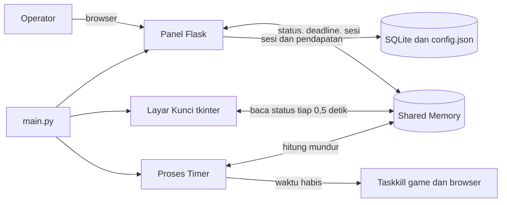

# Z-NET Billing Warnet

Billing sederhana untuk warnet: PC client terkunci layar penuh, operator membuka kunci dari panel web berdasarkan durasi/paket. Dibangun dengan Python (tkinter + Flask + SQLite).

> Masih dalam pengembangan. Uji dulu sebelum dipakai di warnet produksi.

## Fitur

- Layar kunci fullscreen yang menutupi PC client; proses (game/browser) dimatikan otomatis saat waktu habis
- Panel operator berbasis web dengan login token
- Tarif per jam + paket durasi, semuanya di `data/config.json` (tinggal diubah, tidak perlu sentuh kode)
- Sesi dan pendapatan tersimpan di SQLite, sisa waktu & biaya tampil live di panel
- Sesi aktif otomatis dipulihkan kalau aplikasi mati/restart di tengah sesi
  
## Cara kerja

Semua proses berjalan di PC client, berkomunikasi lewat shared memory, dan data tersimpan lewat satu gerbang tunggal (`core/storage.py`):



## Struktur

```
main.py                  entry point, wiring semua proses
client/lock_screen.py    layar kunci (proses terpisah)
client/process_killer.py matikan proses saat waktu habis
core/billing.py          hitung biaya & format rupiah/durasi
core/monitor.py          penghitung waktu (proses terpisah)
core/storage.py          satu-satunya gerbang config.json + SQLite
server/web_server.py     panel operator (Flask)
server/templates/        HTML panel & login
data/                    config.json + billing.db (dibuat saat runtime)
```

## Cara menjalankan

```
pip install -r requirements.txt
python main.py
```

Buka `http://localhost:5000`, login dengan token operator dari `data/config.json`. **Default `admin123` — ganti sebelum dipakai.**

## Konfigurasi

Edit `data/config.json` (dibuat otomatis dari `data/config.example.json` saat pertama jalan):

- `tarif_per_jam` — harga per jam
- `paket` — tombol shortcut durasi di panel
- `kill_processes` — daftar proses yang dimatikan saat waktu habis
- `server` — host/port panel
- `operator_token` — password login operator

## Catatan keamanan

- Panel dan `config.json` berada di PC client. Orang yang bisa baca file di PC itu bisa menemukan token. Untuk penuh aman, panel operator harusnya berjalan di PC kasir terpisah (lihat roadmap).
- Layar kunci masih bisa dilewati lewat Task Manager / Alt+Tab; mode kiosk butuh pengamanan tambahan.

## Roadmap

-  Panel operator di PC kasir terpisah (client hanya menerima perintah)
-  Manajemen multi-PC
-  Member / deposit
-  Laporan harian + struk
-  Mode kiosk yang lebih kuat (blokir Task Manager, Win key, dst)
